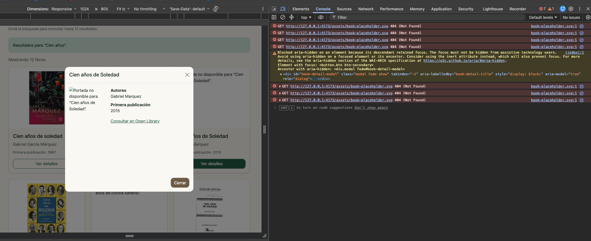
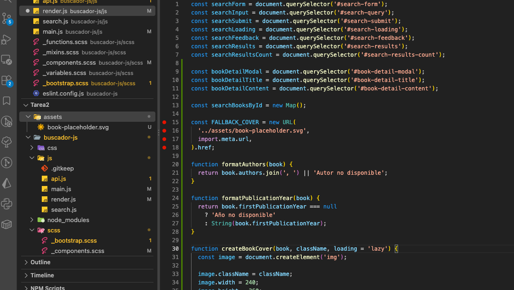
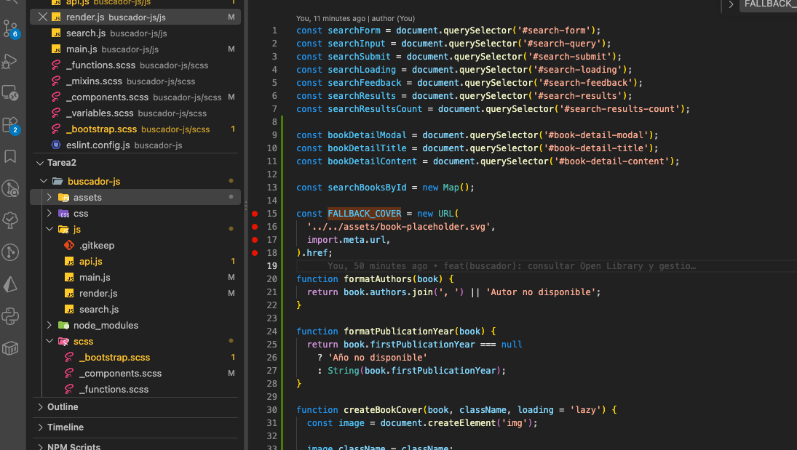
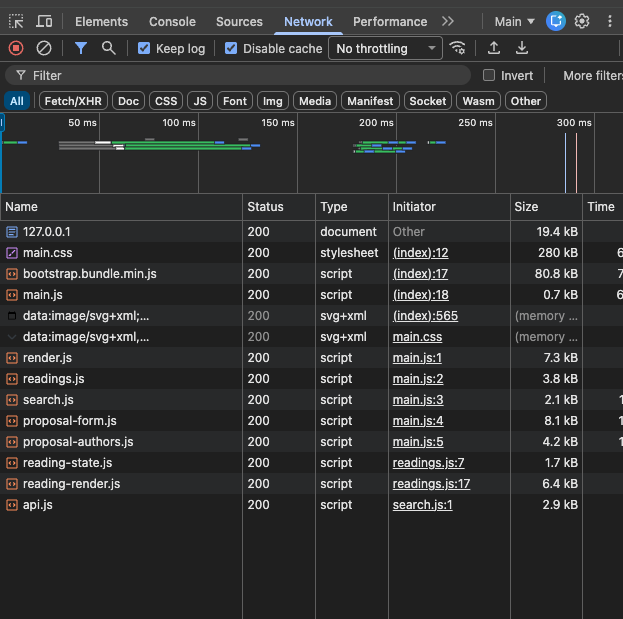
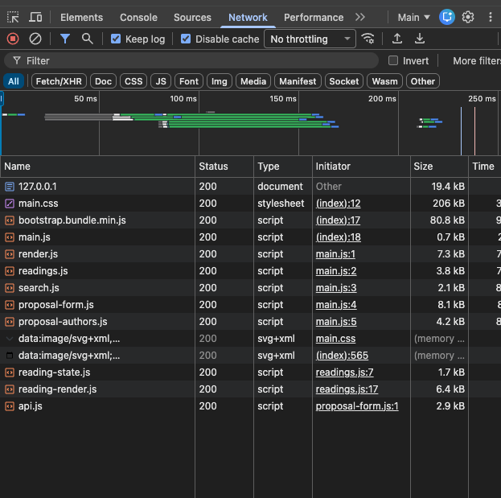

# Depuración y optimización del buscador

## 1. Error de carga de la portada de respaldo

### Comportamiento observado

Algunos resultados y el modal de detalles mostraban una imagen rota
cuando debía aparecer la portada de respaldo.

La consola del navegador registraba respuestas HTTP 404 para:

`http://127.0.0.1:4173/assets/book-placeholder.svg`

### Investigación

Se revisó el manejo de imágenes en `buscador-js/js/render.js` y se
colocaron breakpoints en Visual Studio Code para examinar el código
relacionado con las portadas.

La siguiente captura muestra la ubicación de los breakpoints.

Al revisar la estructura de carpetas, se identificó que `assets`
estaba en la raíz del repositorio, fuera de `buscador-js`, que era
la carpeta publicada por el servidor de desarrollo.

Por tanto, el servidor no podía entregar el archivo solicitado
desde su ruta `/assets/book-placeholder.svg`.

### Solución aplicada

Se movió la carpeta de recursos dentro de `buscador-js`, dejando
el archivo en:

`buscador-js/assets/book-placeholder.svg`

La implementación quedó utilizando esta referencia desde
`buscador-js/js/render.js`:

~~~js
const FALLBACK_COVER = new URL(
  '../../assets/book-placeholder.svg',
  import.meta.url,
).href;
~~~

La disponibilidad del archivo se corrigió al colocarlo dentro
de la carpeta publicada por el servidor.

## 2. Optimización del CSS de Bootstrap

### Situación inicial

El archivo `buscador-js/scss/_bootstrap.scss` importaba Bootstrap
completo, incluyendo estilos de componentes que la aplicación
no utilizaba.

### Cambio realizado

Se sustituyó la importación completa por importaciones de las
dependencias, componentes y utilidades utilizados por el buscador.

Se conservaron las variables de personalización y los estilos
propios de la aplicación.

Los módulos seleccionados incluyen estilos para formularios,
botones, navegación, tarjetas, tablas, alertas, modal y otros
elementos presentes en la interfaz.

El cambio se realizó en:

[`_bootstrap.scss`](../buscador-js/scss/_bootstrap.scss)

### Tamaño del archivo generado

Los tamaños se registraron sobre `css/main.css` después de
compilar cada versión mediante `npm run build:css`.

| Medición | Antes | Después |
| --- | ---: | ---: |
| Tamaño del archivo CSS | 280 182 bytes | 205 182 bytes |

Reducción absoluta:

`280 182 - 205 182 = 75 000 bytes`

Reducción porcentual:

`(75 000 / 280 182) × 100 = 26,77 %`

El registro de los tamaños está en:

[`16-css-bytes.txt`](capturas/16-css-bytes.txt)

### Evidencias de Network

Las capturas muestran la carga inicial del buscador con la caché
deshabilitada, sin limitación artificial de conexión y sin una
búsqueda de libros en el registro visible.

Antes de la optimización:

Después de la optimización:

| Indicador observado | Antes | Después |
| --- | ---: | ---: |
| Solicitudes HTTP visibles | 12 | 12 |
| Entradas de imágenes mediante URL `data:` | 2 | 2 |
| Tamaño mostrado para `main.css` | 280 kB | 206 kB |
| Suma aproximada de tamaños HTTP visibles | 417,4 kB | 343,4 kB |

Las dos entradas con URL `data:` corresponden a imágenes
incorporadas en el CSS y no representan solicitudes HTTP
adicionales.

La suma aproximada se calculó a partir de los valores redondeados
de la columna Size de las doce solicitudes HTTP visibles.

### Resultado

La selección de módulos redujo el tamaño del CSS generado en
26,77 %. El número de solicitudes HTTP visibles permaneció igual,
porque los estilos seleccionados siguen compilándose en un único
archivo `main.css`.

Estas mediciones acreditan una reducción de tamaño optimizando el peso de la aplicación.